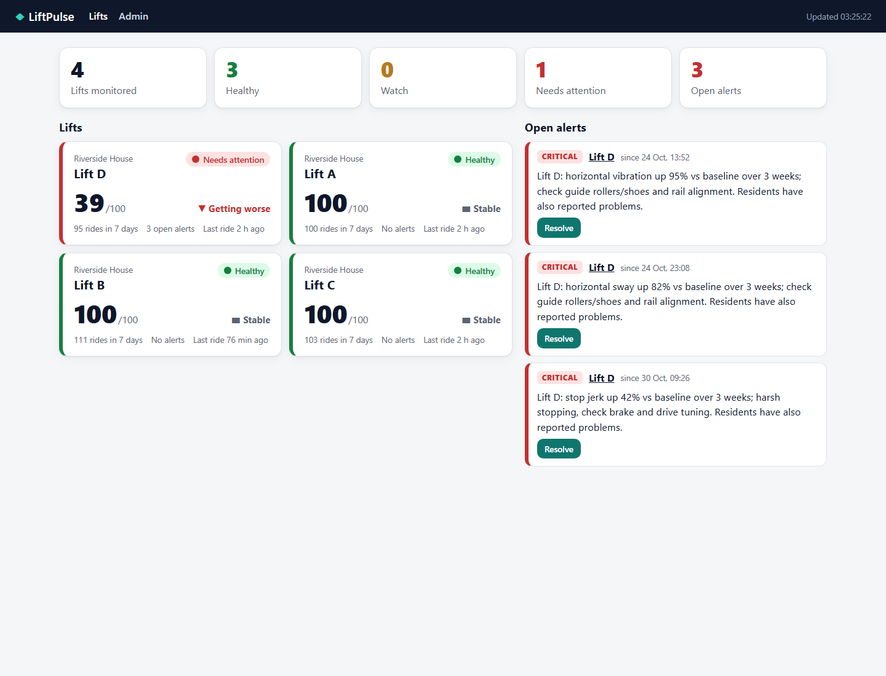
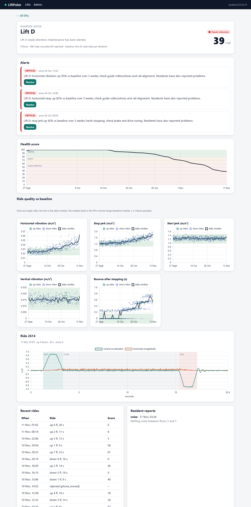
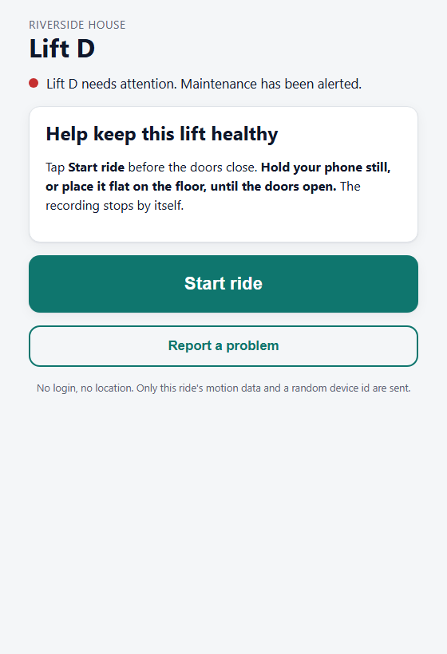
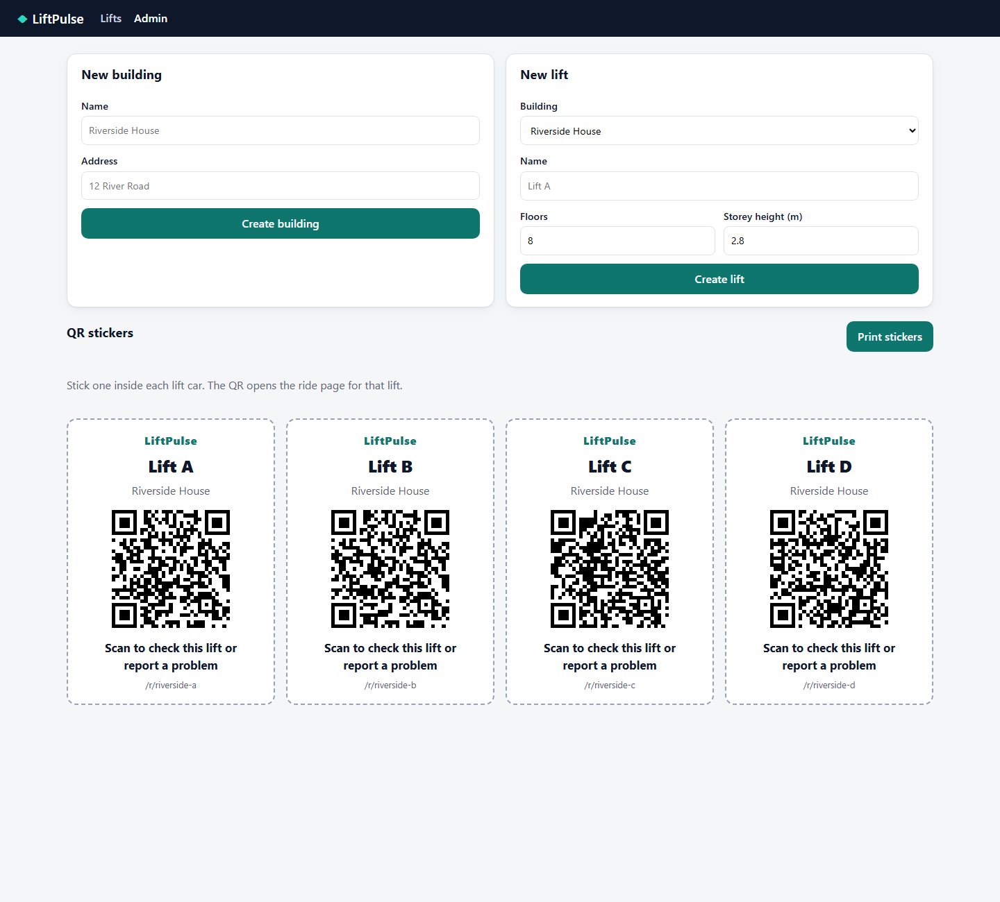

# LiftPulse

**A continuous health check for lifts (elevators), built from the motion sensors of riders' phones.**
No hardware in the lift, no wiring, no app install and no machine learning: a resident scans a QR
code in the car, taps *Start ride*, and the phone's accelerometer becomes a ride-quality
measurement. Signal processing turns each ride into features (acceleration, jerk, vibration,
bounce); robust statistics compare them with what is normal for *that* lift; maintenance sees a
health score and plain-language alerts such as

> **Lift D: stop jerk up 42% vs baseline over 3 weeks; harsh stopping, check brake and drive tuning.**



[](https://github.com/amandesi13/liftpulse/actions/workflows/ci.yml)

## How it works

```
 phone (web page, no app)            server (FastAPI)                       maintenance
 ─────────────────────────           ──────────────────────────────────     ─────────────────
 QR in the car → /r/<lift>   ──►  1. resample to 100 Hz                     dashboard: health
 DeviceMotion, 60–100 Hz          2. gravity from the first still 0.5 s     per lift, trend,
 auto-stop after the lift         3. vertical / horizontal split            alert feed
 has stopped for 3 s              4. ISO 18738-style filtering (10 / 5 Hz)
 POST raw samples                 5. start · cruise · stop phases           lift page: health
                                  6. validity checks (handled, walking…)    over time, features
                                  7. features → robust z vs baseline        vs normal band,
                                  8. ride score → lift health → trends      ride traces
```

1. **Ride page** ([`static/ride.js`](static/ride.js)). Records `accelerationIncludingGravity` and
   `rotationRate`. It asks for the iOS motion permission inside the tap, keeps the screen awake,
   shows a live trace, and stops by itself once the lift has started, braked and stood still for 3 s.
2. **Signal processing** ([`app/signal.py`](app/signal.py), pure NumPy/SciPy).
   - **Orientation-independent:** the vertical axis is the measured gravity direction, so it works
     with the phone flat on the floor or held at an angle, and with either sign convention browsers
     use.
   - **Rejects unusable recordings** with a readable reason.
   - **Extracts 13 features**, including peak acceleration and jerk at start and stop, vertical and
     horizontal vibration (RMS, peak-to-peak, dominant frequency), speed, distance, floors and
     post-stop settling time.
3. **Scoring** ([`app/scoring.py`](app/scoring.py), rule-based).
   - **Baseline:** the median and MAD of each lift's first 20 valid rides, per direction.
   - **Ride score:** 0–100, from weighted penalties on robust z-scores.
   - **Lift health:** the rolling median of ride scores.
   - **Alerts:** from a 21-day trend regression, or from repeated outliers. Each names the likely
     cause, and resident reports escalate them.
4. **Dashboard** ([`static/`](static), vanilla JS and Chart.js, no build step).

Why each choice was made is in [`DECISIONS.md`](DECISIONS.md).

| Lift detail | Resident page | QR stickers |
|---|---|---|
|  |  |  |

## Run it

### Locally

```bash
python -m venv .venv && source .venv/bin/activate      # Windows: .venv\Scripts\activate
pip install -r requirements-dev.txt
export LIFTPULSE_ADMIN_TOKEN=demo                       # Windows: set LIFTPULSE_ADMIN_TOKEN=demo
python -m sim.simulate seed --days 45                   # demo data, ~3 min, no server needed
uvicorn app.main:app --reload
```

Open http://localhost:8000/dashboard?token=demo. The API docs are at `/docs`.

### With Docker

```bash
LIFTPULSE_ADMIN_TOKEN=demo docker compose up -d --build
docker compose exec liftpulse python -m sim.simulate seed --days 45
```

Kubernetes manifests are in [`deploy/k8s/`](deploy/k8s): a single-replica Deployment (SQLite), a
Service, a PVC, and an example Secret.

### On a phone (HTTPS required)

Browsers expose motion sensors only on secure (`https://`) pages, so tunnel the local server:

```bash
cloudflared tunnel --url http://localhost:8000      # or: ngrok http 8000
```

Use the printed `https://…` URL. Restart the server with `LIFTPULSE_PUBLIC_URL=https://…` so the
QR codes point to the tunnel, then print the stickers from `/admin`.

- **iPhone (Safari):** the first tap on *Start ride* shows "Allow access to motion and
  orientation". Tap *Allow*. If it was denied once, clear the site's data in Settings → Safari
  → Advanced → Website Data, then reload.
- **Android (Chrome):** no prompt; it works over https.

### Configuration

| Variable | Default | |
|---|---|---|
| `LIFTPULSE_ADMIN_TOKEN` | `change-me` | Shared token for the dashboard and admin API (header `X-Admin-Token` or `?token=`). |
| `LIFTPULSE_DATABASE_URL` | `sqlite:///./data/liftpulse.db` | Any SQLAlchemy URL; PostgreSQL works unchanged. |
| `LIFTPULSE_PUBLIC_URL` | request URL | Base URL printed in QR codes. |
| `LIFTPULSE_BASELINE_RIDES` | `20` | Valid rides per direction that form a lift's baseline. |
| `LIFTPULSE_STORE_RAW` | `1` | Keep raw samples (needed for ride traces and re-analysis). |

## Demo data

```bash
python -m sim.simulate seed --days 45 [--reset]          # in-process; or --url http://host:8000
python -m sim.simulate live --url http://localhost:8000  # a new ride every 4 s
```

The simulator generates physically plausible raw traces and posts them to the same
`POST /api/rides` endpoint a phone uses, so the whole pipeline runs:
- **Motion:** jerk-limited S-curve profiles, speed-dependent car vibration, post-stop bounce and
  ride-to-ride variation with car load.
- **Phones:** random orientation, noise, bias, irregular timing and both sign conventions.
- **Bad recordings:** about 5 % of rides are deliberately unusable (phone picked up, walking, too
  short).

The demo building has 4 lifts. Lift D wears out from day 15: rising horizontal vibration (guide
rollers), harsher stops (brake/drive tuning) and more bounce (levelling). It starts warning around
day 29, turns yellow, then red. Lifts A–C stay green.

## Five-minute pitch demo

**Before:** seed the data, start the server behind a tunnel, print a sticker for a real lift
(`/admin`), and open `/dashboard?token=…` on the projector.

1. **Dashboard (1 min).** "Four lifts, three healthy, Lift D needs attention." Point at the alert
   feed. Each alert is a sentence a technician can act on.
2. **Lift D (1 min).** Open Lift D. Health has slid from 100 to about 40 over three weeks, and
   horizontal vibration and stop jerk have climbed out of their normal band. "We saw this coming
   weeks before anyone complained."
3. **Live ride (2 min).** In the real lift, scan the sticker, tap *Start ride*, put the phone on
   the floor, and ride. The page stops by itself and shows "Thanks, ride recorded: up 3 floors in
   14 s" with the lift's status. Back on the dashboard, the ride count updates within 5 s.
4. **Residents (30 s).** Tap *Report a problem → Shaking*. The Lift D alerts escalate and note
   that residents reported it too.
5. **Keep it moving (optional).** Run `python -m sim.simulate live --url …` in a terminal, so rides
   keep arriving while you talk.

## API

| | |
|---|---|
| `POST /api/rides` | `{lift_id, device_id, sample_rate_hint, samples: [[t_ms, ax, ay, az, rx, ry, rz], …]}` → validity, features, ride score, lift status |
| `GET /api/lifts/{id}/status` | Public status for the resident page |
| `POST /api/reports` | `{lift_id, category, comment}`; categories: stuck, noise, shaking, door, not_level, other |
| `GET /api/lifts` · `GET /api/lifts/{id}` | Dashboard overview · detail (health history, feature series, baselines, reports, alerts) |
| `GET /api/lifts/{id}/rides` · `GET /api/rides/{id}` | Ride list · one ride with its processed trace and phases |
| `GET /api/alerts` · `POST /api/alerts/{id}/resolve` | Alert feed |
| `POST /api/admin/lifts` · `GET /api/admin/lifts/{id}/qr.png` · `POST /api/admin/recompute` | Admin |

## Tests

```bash
pytest          # 82 tests, ~15 s
```

- **Signal processing** against synthetic rides with known answers: direction, distance within
  10 % and peak jerk within 15 %, across floors, directions and phone orientations; unusable
  recordings rejected with the right reason.
- **Scoring:** a healthy lift stays green, a degrading lift raises alerts and turns red, too few
  rides gives grey.
- **API flows** end to end, and the simulator.

CI runs them on Python 3.11 and 3.12, then builds the Docker image and smoke-tests it.

## Project layout

```
app/       main.py (routes) · signal.py · scoring.py (pure) · pipeline.py (DB glue) · views.py · models.py
static/    ride page · dashboard · lift page · admin (plain HTML/JS)
sim/       ridegen.py (physics + phone model) · simulate.py (seed / live)
tests/     pytest suite
deploy/    Kubernetes manifests
```

## Known limitations

- **Not yet validated on real phones in real lifts.** Every result so far comes from synthetic
  data. The thresholds in `signal.Limits` and the score weights need calibrating against real
  recordings, and against maintenance records, before anyone relies on them.
- **No barometer:** browsers don't expose it, so levelling and stop accuracy are estimated
  indirectly, from post-stop settling.
- **Phone variability:** sensor noise, sample rate and hand tremor differ between phones. Robust
  per-lift baselines absorb part of this; per-device normalisation would be the next step.
- **Background tabs:** most browsers stop motion events when the screen locks or the tab is in the
  background. The page requests a wake lock to prevent this.
- **One unit per baseline:** features are compared with the lift's own first rides. If a lift was
  already worn when monitoring started, that wear becomes its "normal".
- **MVP security:** one shared admin token, no rate limiting on public uploads.

## License

MIT, see [LICENSE](LICENSE).
